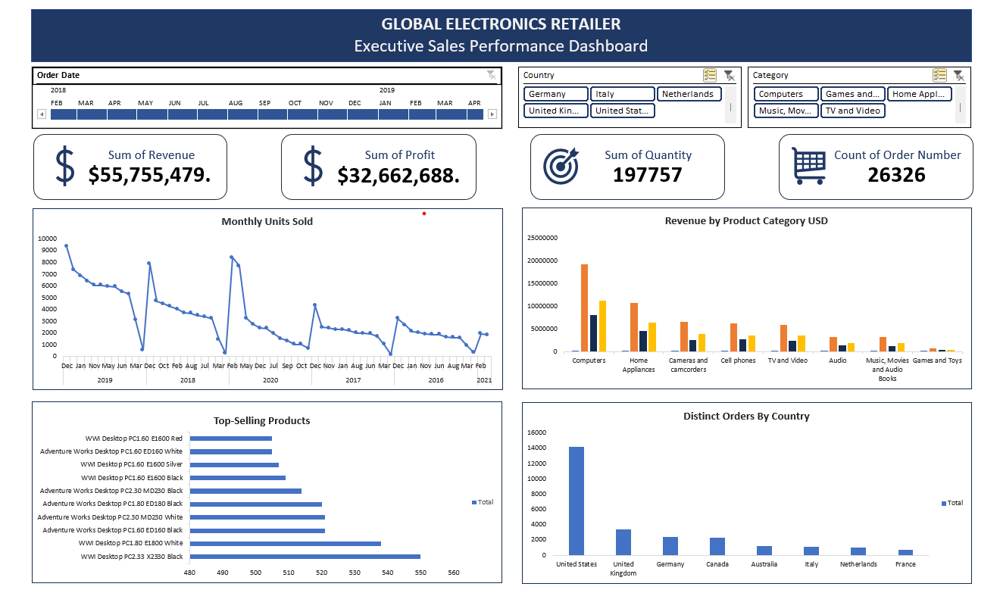

# Global Electronics Retailer — Sales Analysis in Excel

## Project Overview

This project analyses sales data from a fictional global electronics retailer using Microsoft Excel. The objective was to prepare and validate the data, establish relationships between related tables, calculate sales performance metrics, identify business trends, and build an interactive executive dashboard.

The project demonstrates an end-to-end Excel analytics workflow, combining Power Query for data preparation, Power Pivot and the Excel Data Model for relational analysis, and PivotTables and PivotCharts for reporting and visualisation.

## Business Questions

The analysis explores the following questions:

- Which products have the highest sales volumes?
- Which product categories generate the highest estimated revenue and profit?
- How are orders distributed across customer countries?
- How does sales volume change over time?
- Which customers place orders most frequently?
- How can an interactive dashboard support the exploration of these results?

## Tools and Techniques

| Tool or Technique | Application |
|---|---|
| Microsoft Excel | Data analysis, calculations, reporting, and dashboard development |
| Power Query | Data inspection, type correction, missing-value checks, and data-quality validation |
| Power Pivot and Excel Data Model | Relational modelling and analysis across related tables |
| PivotTables | Aggregation, distinct order counts, and performance comparisons |
| Calculated columns | Estimation of revenue, total cost, and profit |
| PivotCharts | Visualisation of product, category, geographic, and monthly trends |
| Slicers and timeline | Interactive filtering by customer country, product category, and order date |

## Dataset

The project uses the [Global Electronics Retailer dataset from Maven Analytics](https://mavenanalytics.io/data-playground/global-electronics-retailer).

The workbook contains six tables:

| Table | Purpose |
|---|---|
| Sales | Order and delivery dates, customer and product keys, store keys, quantities, and currency codes |
| Products | Product names, categories, unit costs, and unit prices |
| Customers | Customer information and country |
| Stores | Store information and geographic attributes |
| Exchange Rates | Currency exchange-rate records |
| Data Dictionary | Definitions of the dataset fields |

The dataset represents a fictional retailer and is used for portfolio and analytical demonstration purposes.

## Data Preparation and Modelling

### 1. Data Preparation with Power Query

Power Query was used to inspect and prepare the source tables before analysis. Key activities included:

- Correcting the interpretation and data type of order dates.
- Setting the Quantity column to a whole-number data type.
- Checking missing values, errors, and duplicate records.
- Retaining blank delivery dates rather than replacing them with assumed dates.
- Reviewing quantity values for possible return-related records.

The preparation process focused on preserving the source information while correcting identifiable data-type issues and checking data quality.

### 2. Relational Modelling with Power Pivot

The tables were loaded into the Excel Data Model. Relationships were established between the Sales table and the relevant dimension tables:

- `Sales[CustomerKey]` → `Customers[CustomerKey]`
- `Sales[ProductKey]` → `Products[ProductKey]`
- `Sales[StoreKey]` → `Stores[StoreKey]`

These relationships enabled sales records to be analysed using customer, product, and store attributes without manually combining the tables into a single flat dataset.

### 3. Calculated Metrics

Calculated columns were used to estimate the financial performance of individual sales line items.

| Metric | Calculation |
|---|---|
| Revenue | Unit Price USD × Quantity |
| Total Cost | Unit Cost USD × Quantity |
| Profit | Revenue − Total Cost |

The calculations use the listed USD unit prices and unit costs in the Products table.

**Important methodology note:** These values are estimates rather than verified accounting figures. The calculations do not independently account for discounts, taxes, shipping, returns, or other transaction-level adjustments. They should therefore be interpreted as indicative measures of sales performance.

## Key Findings

### 1. Top-Selling Products by Quantity

The three highest-volume products identified in the analysis were:

| Product | Quantity Sold |
|---|---:|
| WWI Desktop PC2.33 X2330 Black | 550 |
| WWI Desktop PC1.80 E1800 White | 538 |
| Adventure Works Desktop PC1.60 ED160 Black | 521 |

**Business insight:** These products recorded the highest quantities among the products analysed, making them useful candidates for further investigation into product demand, inventory planning, and sales performance.

### 2. Product Category Performance

The following categories ranked highest by estimated revenue among the leading categories identified:

| Product Category | Quantity | Estimated Revenue (USD) | Estimated Total Cost (USD) | Estimated Profit (USD) |
|---|---:|---:|---:|---:|
| Computers | 44,151 | $19,301,595.46 | $8,024,147.56 | $11,277,447.90 |
| Home Appliances | 18,401 | $10,795,478.59 | $4,499,139.74 | $6,296,338.85 |
| Cameras and camcorders | 17,609 | $6,520,168.02 | $2,600,367.03 | $3,919,800.99 |

**Business insight:** Computers generated the highest estimated revenue and profit among these categories. This makes the category a useful starting point for further analysis of product mix, demand, and estimated profitability.

### 3. Order Distribution by Customer Country

Using the country field in the Customers table, the highest distinct order counts among the countries shown were:

| Customer Country | Distinct Orders |
|---|---:|
| United States | 14,211 |
| United Kingdom | 3,421 |
| Germany | 2,440 |

**Business insight:** The United States had the highest distinct order count among the countries shown. This geographic view can help identify where order activity is concentrated and where additional market analysis may be useful.

### 4. Monthly Sales Volume

The monthly trend was analysed using the **sum of Quantity**, rather than revenue.

- **Highest month:** December 2019 — 9,343 units.
- **Lowest month:** April 2017 — 161 units.

Annual quantities increased from 2016 through 2019, followed by a decline in 2020. The available 2021 records cover January and February only, so 2021 represents an incomplete year and should not be compared directly with full-year totals.

**Business insight:** The monthly pattern provides a starting point for investigating changes in product demand and potential seasonality. Further analysis would be needed to establish the causes of individual peaks and declines.

### 5. Customer Order Activity

The following customers recorded the highest distinct order counts among the customer records highlighted in the analysis:

| Customer Key | Distinct Orders |
|---:|---:|
| 723572 | 14 |
| 2080484 | 12 |
| 1349131 | 11 |

**Business insight:** Distinct order count measures order frequency, not customer spending, profitability, or lifetime value. Additional customer-level revenue and profit analysis would be needed to identify the most valuable customers financially.

## Interactive Executive Dashboard

The Excel dashboard brings key performance indicators and visualisations together in a single worksheet, allowing users to explore sales performance interactively.

### Key Performance Indicators

The dashboard includes four KPI cards:

- **Total Revenue (USD)**
- **Total Profit (USD)**
- **Units Sold**
- **Distinct Orders**

These indicators provide a high-level summary of sales activity and estimated financial performance.

### Dashboard Visualisations

The dashboard contains four charts:

1. **Top-Selling Products by Quantity** — compares product sales volumes.
2. **Revenue by Product Category (USD)** — compares estimated revenue across categories.
3. **Monthly Sales Trend (Sum of Quantity)** — shows changes in sales volume over time.
4. **Order Distribution by Customer Country** — compares distinct order counts across customer countries.

### Interactive Filters

The dashboard includes:

- **Country slicer:** filters results by customer country.
- **Product Category slicer:** filters results by product category.
- **Order Date timeline:** filters results by the selected date range.

The workbook was saved, closed, and reopened to verify that the dashboard and its interactive filters continued to work.

### Dashboard Preview



## Limitations and Considerations

- **Fictional business:** The dataset represents a fictional retailer; the findings should not be interpreted as actual performance for a real electronics company.
- **Estimated financial metrics:** Revenue, total cost, and profit are calculated from listed product prices and costs. They are not verified accounting figures.
- **Currency treatment:** The calculated financial metrics use the listed USD unit prices and costs. The project does not document a completed currency-conversion workflow for the Sales table.
- **Sales trend definition:** The monthly trend measures quantity sold, not revenue.
- **Incomplete 2021 data:** Only January and February are represented in the annual quantity totals for 2021.
- **Returns validation:** The negative-quantity check did not identify negative-quantity records. This does not establish that no returns occurred, since returns may be represented differently or may not be included in the available data.
- **Licence and redistribution:** The source dataset's licence and applicable terms should be checked before redistributing the original data in the workbook or elsewhere.

## Project Structure

```text
global-electronics-retail-analysis/
├── README.md
├── completed-workbook.xlsx
└── executive-dashboard.png
```

- `README.md` — project documentation, methodology, findings, and dashboard overview.
- `completed-workbook.xlsx` — Excel workbook containing the prepared data, Data Model, analyses, and interactive dashboard.
- `executive-dashboard.png` — screenshot of the executive dashboard.

## Conclusion

This project demonstrates the use of Microsoft Excel for data preparation, relational modelling, calculated metrics, business analysis, and interactive dashboard development.

Power Query supported data inspection and preparation, while Power Pivot and the Excel Data Model enabled analysis across related tables. PivotTables, PivotCharts, slicers, and a timeline were used to summarise results and present them in an interactive dashboard.

The project also highlights the importance of documenting assumptions, distinguishing estimated financial metrics from verified accounting figures, and communicating the limitations of a dataset when drawing business conclusions.

**Tools:** Microsoft Excel · Power Query · Power Pivot · Excel Data Model · PivotTables · PivotCharts · Slicers · Timeline

**Project Type:** Data Analytics Portfolio Project
