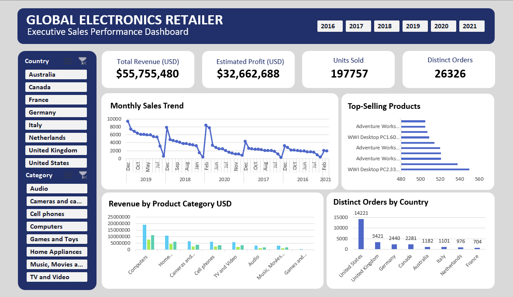

# Global Electronics Retailer — Sales Analysis in Excel

## Project Overview

This project explores sales performance for a fictional global electronics retailer using Microsoft Excel. The objective was to transform raw business data into meaningful insights by cleaning and validating datasets, establishing relationships between related tables, analysing sales performance, and developing an interactive executive dashboard.

The analysis focuses on product performance, category revenue and profitability, geographic order distribution, monthly sales trends, and customer purchasing activity.

The project demonstrates an end-to-end Excel analytics workflow, leveraging **Power Query** for data cleaning and preparation, **Power Pivot and the Excel Data Model** for relational data modelling, and **PivotTables and PivotCharts** for data analysis and visualisation.

## Business Questions

The analysis was guided by the following business questions:

- Which products have the highest sales volumes?
- Which product categories generate the highest estimated revenue and profit?
- How are orders distributed across customer countries?
- How does sales activity change over time?
- Which customers place orders most frequently?
- How can an interactive dashboard communicate key business performance indicators?

## Tools and Techniques

| Tool or Technique | Application |
|---|---|
| Microsoft Excel | Data analysis, calculations, reporting, and dashboard development |
| Power Query | Data cleaning, inspection, transformation, data-type correction, and quality checks |
| Power Pivot | Relational data modelling and calculated columns |
| Excel Data Model | Connecting and analysing multiple related tables |
| PivotTables | Data aggregation, distinct order counts, and performance comparisons |
| Calculated Columns | Revenue, total cost, and estimated profit calculations |
| PivotCharts | Visualising product, category, geographic, and monthly trends |
| Slicers and Timeline | Interactive filtering and dashboard exploration |

## Dataset

The project uses the [Global Electronics Retailer dataset from Maven Analytics](https://mavenanalytics.io/data-playground/global-electronics-retailer).

The dataset contains six tables:

| Table | Description |
|---|---|
| Sales | Transaction records, order and delivery dates, customer and product keys, store keys, quantities, and currency codes |
| Products | Product names, categories, unit costs, and unit prices |
| Customers | Customer details and geographic information |
| Stores | Store details and geographic attributes |
| Exchange Rates | Historical currency exchange-rate records |
| Data Dictionary | Definitions and descriptions of dataset fields |

The dataset represents a fictional electronics retailer and is used for analytical and portfolio demonstration purposes.

## Data Cleaning and Preparation

Data cleaning and preparation were carried out using **Power Query** to inspect, transform, and validate the source tables before analysis.

The following activities were performed:

- Corrected data types, particularly for order dates.
- Set the Quantity column to a whole-number data type.
- Checked for missing values, errors, and duplicate records.
- Retained blank delivery dates rather than introducing assumed values.
- Reviewed quantity values for potential return-related records.

The preparation process focused on maintaining the integrity of the original data while addressing identifiable data-type issues and assessing data quality.

## Data Modelling

After preparation, the tables were loaded into the Excel Data Model and relationships were established using Power Pivot.

### Table Relationships

The Sales table served as the central fact table, connected to the following dimension tables:

- `Sales[CustomerKey]` → `Customers[CustomerKey]`
- `Sales[ProductKey]` → `Products[ProductKey]`
- `Sales[StoreKey]` → `Stores[StoreKey]`

This relational structure enabled analysis of sales transactions using customer, product, and store attributes without manually combining the tables into a single dataset.

The Exchange Rates and Data Dictionary tables were retained as reference tables. The Exchange Rates table was not connected to the Sales table in the current model.

For additional details, see [Data Model Documentation](data-model/data-model-documentation.md).

## Data Analysis and Calculated Metrics

Data analysis was conducted using **Excel Data Model, PivotTables, calculated columns, and PivotCharts** to investigate sales performance and answer the identified business questions.

### Calculated Metrics

Calculated columns were created to estimate the financial performance of individual sales line items.

| Metric | Calculation |
|---|---|
| Revenue | Unit Price USD × Quantity |
| Total Cost | Unit Cost USD × Quantity |
| Estimated Profit | Revenue − Total Cost |

These calculations use the listed USD unit prices and unit costs in the Products table.

### Analytical Procedures

The analysis involved:

- **Product Analysis:** Aggregating quantities sold to identify the highest-volume products.
- **Category Performance Analysis:** Comparing estimated revenue, total cost, and profit across product categories.
- **Geographic Analysis:** Using distinct order counts to examine order distribution by customer country.
- **Time-Series Analysis:** Examining monthly sales activity and annual quantity patterns.
- **Customer Analysis:** Comparing distinct order counts to identify customers with frequent purchasing activity.
- **Performance Reporting:** Consolidating key performance indicators and analytical findings for dashboard presentation.

PivotTables were used to aggregate and compare the data, while PivotCharts provided visual representations of the resulting insights.

**Methodological Note:** The financial figures are estimates rather than verified accounting results. The calculations do not independently account for discounts, taxes, shipping costs, returns, or other transaction-level adjustments. They should therefore be interpreted as indicative measures of sales performance.

## Key Findings and Business Insights

### 1. Top-Selling Products by Quantity

The three highest-volume products identified were:

| Product | Quantity Sold |
|---|---:|
| WWI Desktop PC2.33 X2330 Black | 550 |
| WWI Desktop PC1.80 E1800 White | 538 |
| Adventure Works Desktop PC1.60 ED160 Black | 521 |

**Business Insight:** These products recorded the highest sales quantities among the products analysed. Their performance makes them potential candidates for further investigation into customer demand, inventory planning, and product availability.

### 2. Product Category Performance

The following product categories recorded the highest estimated revenue among the leading categories analysed:

| Product Category | Quantity | Estimated Revenue (USD) | Estimated Total Cost (USD) | Estimated Profit (USD) |
|---|---:|---:|---:|---:|
| Computers | 44,151 | $19,301,595.46 | $8,024,147.56 | $11,277,447.90 |
| Home Appliances | 18,401 | $10,795,478.59 | $4,499,139.74 | $6,296,338.85 |
| Cameras and camcorders | 17,609 | $6,520,168.02 | $2,600,367.03 | $3,919,800.99 |

**Business Insight:** Computers generated the highest estimated revenue and profit among the categories presented. This suggests that the category deserves further attention when evaluating product mix, demand, and estimated profitability.

### 3. Order Distribution by Customer Country

Using the country field in the Customers table, the following countries recorded the highest distinct order counts among those highlighted:

| Customer Country | Distinct Orders |
|---|---:|
| United States | 14,211 |
| United Kingdom | 3,421 |
| Germany | 2,440 |

**Business Insight:** The United States recorded the highest distinct order count among the countries shown. This geographic distribution provides a useful starting point for examining market concentration and identifying opportunities for further regional analysis.

### 4. Monthly Sales Volume

Monthly sales activity was examined using the sum of Quantity.

Key observations included:

- **Highest month:** December 2019 — 9,343 units.
- **Lowest month:** April 2017 — 161 units.
- Annual quantities increased from 2016 through 2019, followed by a decline in 2020.
- The available 2021 records cover January and February only, making 2021 an incomplete reporting year.

**Business Insight:** The monthly sales pattern provides an opportunity to investigate changes in product demand and potential seasonality. Further analysis would be required to establish the reasons behind specific peaks and declines.

### 5. Customer Order Activity

The following customers recorded the highest distinct order counts among the customer records highlighted:

| Customer Key | Distinct Orders |
|---:|---:|
| 723572 | 14 |
| 2080484 | 12 |
| 1349131 | 11 |

**Business Insight:** Order frequency provides an indication of customer purchasing activity. However, a higher order count does not necessarily translate into higher spending or profitability. Additional analysis of customer revenue and profit would be required to identify the most financially valuable customers.

## Interactive Executive Dashboard

An interactive executive dashboard was developed to provide a consolidated view of the retailer's sales performance.

The dashboard combines four key performance indicators with four visualisations, allowing users to explore business performance through interactive filters.

### Key Performance Indicators (KPIs)

| KPI | Value |
|---|---:|
| Total Revenue (USD) | $55,755,480 |
| Estimated Profit (USD) | $32,622,688 |
| Units Sold | 197,757 |
| Distinct Orders | 26,326 |

*Note: Revenue and profit are estimates calculated using the listed USD unit prices and costs in the Products table. These figures are not audited financial results.*

### Dashboard Visualisations

The dashboard features four charts:

1. **Monthly Sales Trend:** Presents monthly sales activity over time.
2. **Top-Selling Product:** Highlights product sales performance.
3. **Revenue by Product Category (USD):** Compares revenue contributions across product categories.
4. **Distinct Orders by Country:** Examines the geographic distribution of customer orders.

### Interactive Filters

The dashboard incorporates interactive controls to support further exploration:

- **Country Slicer:** Filters results by customer country.
- **Product Category Slicer:** Filters performance by product category.
- **Order Date Timeline:** Enables date-based analysis across the available reporting period.

### Dashboard Preview



## Limitations and Considerations

- **Fictional Dataset:** Represents a fictional retailer, not an actual business.
- **Estimated Metrics:** Revenue, cost, and profit are estimates, not verified accounting figures.
- **Currency:** Analysis uses listed USD prices; currency conversion was not performed.
- **2021 Data:** Only January and February records are available.
- **Returns:** No negative quantities were identified, but this does not rule out returns.

## Project Structure

```text
global-electronics-retail-analysis/
│
├── data-model/
│   ├── data-model-documentation.md
│   └── data-model-relationships.png
│
├── Executive-dashboard.png
├── README.md
└── completed-workbook.xlsx
```

### Repository Contents

- **README.md:** Project overview, data cleaning, preparation, analysis, key findings, and dashboard documentation.
- **completed-workbook.xlsx:** Excel workbook containing the prepared data, Data Model, analysis, and interactive dashboard.
- **Executive-dashboard.png:** Preview of the interactive executive dashboard.
- **data-model/:** Contains the data model documentation and relationship diagram.
  - **data-model-documentation.md:** Explains the data model, table roles, and relationships.
  - **data-model-relationships.png:** Visual representation of the data model and table relationships.

## Conclusion

This project demonstrates how Microsoft Excel can be used to transform raw business data into structured analysis and meaningful business insights.

Through Power Query, the source tables were cleaned, inspected, and prepared for analysis. Power Pivot and the Excel Data Model enabled relational analysis across multiple datasets, while calculated columns, PivotTables, and PivotCharts supported the investigation of sales performance.

The interactive executive dashboard brings the key findings together, making it easier to explore product performance, category contributions, geographic order distribution, and sales activity over time.

Beyond the technical implementation, the project reinforces the importance of data quality, sound analytical methodology, transparent assumptions, and effective communication when using data to support business decisions.

---

**Tools:** Microsoft Excel · Power Query · Power Pivot · Excel Data Model · PivotTables · PivotCharts · Slicers · Timeline

**Project Type:** Data Analytics Portfolio Project
